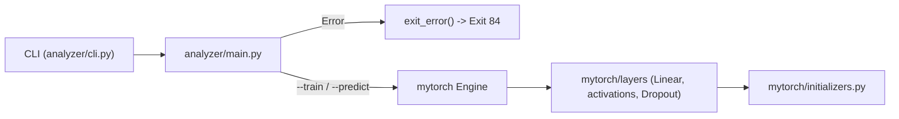

# Project Structure & Architecture

This document explains the directory layout, architectural design, and core modules of **OurTorch**.

---

## 1. Directory Structure

```text
OurTorch/
├── Makefile                    # Build system for my_torch_analyzer & my_torch_generator
├── README.md                   # General project overview and usage guide
├── ARCHITECTURE.md             # Detailed structure and technical explanations
├── .gitignore                  # Git ignore rules for caches, venvs, and binaries
│
├── mytorch/                    # Custom lightweight neural network library
│   ├── __init__.py             # Package initialization
│   ├── initializers.py         # Weight initialization strategies (Xavier, He, LeCun)
│   └── layers/                 # Neural network layers package
│       ├── __init__.py         # Exposes Layer and every concrete layer
│       ├── base.py             # Abstract base class `Layer`
│       ├── dense.py            # `Linear` (fully connected) layer
│       ├── activations.py      # ReLU, LeakyReLU, Sigmoid, Tanh, Softmax
│       └── regularization.py   # `Dropout` / MC Dropout
│
├── analyzer/                   # Chessboard analyzer application
│   ├── __init__.py             # Package initialization
│   ├── main.py                 # Entrypoint copied to ./my_torch_analyzer
│   ├── cli.py                  # Strict CLI parser & argument validator
│   └── utils.py                # Central error handling (`exit_error`)
│
├── scripts/                    # Standalone scripts and tools
│   └── generator.py            # Entrypoint copied to ./my_torch_generator
│
└── tests/                      # Unit test suite
    ├── __init__.py             # Test path configuration
    ├── gradcheck.py            # Reusable numerical gradient checker (finite differences)
    ├── test_cli.py             # Unit tests for CLI parsing and exit code 84 rules
    ├── test_initializers.py    # Unit tests for initializers and base Layer
    └── test_layers.py          # Gradient checks and behaviour tests for every layer
```

---

## 2. Build System (`Makefile`)

Because Python is an interpreted language, the `Makefile` packages the entrypoints as standalone executables using standard POSIX permissions and the `#!/usr/bin/env python3` shebang at the top of each entrypoint:

| Rule | Action |
| :--- | :--- |
| `make` / `make all` | Copies `analyzer/main.py` $\rightarrow$ `./my_torch_analyzer` and `scripts/generator.py` $\rightarrow$ `./my_torch_generator`, and runs `chmod +x` on both. |
| `make clean` | Removes `__pycache__`, `.pytest_cache`, and `*.pyc` files across the workspace. |
| `make fclean` | Runs `clean` and deletes `./my_torch_analyzer` and `./my_torch_generator`. |
| `make re` | Runs `fclean` followed by `all`. |

---

## 3. Core Modules Breakdown

### 3.1 Analyzer Package (`analyzer/`)

#### `analyzer/utils.py`
Provides centralized error reporting required by the specification:
- **`exit_error(message: str) -> None`**:
  Writes `f"Error: {message}\n"` to `sys.stderr` and terminates the process with `sys.exit(84)`.

#### `analyzer/cli.py`
Handles command-line parsing without relying on `argparse`'s default exit code (`2`), ensuring every validation failure exits with code `84`.
- **`AnalyzerArgs`**: A `@dataclass` holding the validated parameters:
  - `mode: str` (`"train"` or `"predict"`)
  - `loadfile: str` (path to the neural network file)
  - `chessfile: str` (path to the FEN dataset file)
  - `savefile: Optional[str]` (optional output path when `--train` is active)
- **Validation Rules**:
  1. `-h` or `--help` prints the exact specification usage to `stdout` and exits with `0`.
  2. Exactly one mode (`--train` or `--predict`) must be specified.
  3. `--save SAVEFILE` is only permitted with `--train` (using `--save` with `--predict` exits with `84`).
  4. Both `LOADFILE` and `CHESSFILE` must exist, be regular files, be readable, and be non-empty (`size > 0`).

---

### 3.2 Neural Network Library (`mytorch/`)

#### `mytorch/initializers.py`
Implements standard weight initialization strategies to prevent vanishing or exploding gradients during forward and backward propagation. All functions accept `shape: tuple[int, int]` representing `(n_in, n_out)` and return a `np.ndarray` of dtype `np.float32`.

| Function | Formula / Distribution | Typical Use Case |
| :--- | :--- | :--- |
| `xavier_normal(shape)` | $\mathcal{N}\!\left(0, \sqrt{\frac{2}{n_{\text{in}} + n_{\text{out}}}}\right)$ | Tanh / Sigmoid / Logistic activations |
| `xavier_uniform(shape)` | $\mathcal{U}\!\left(-\sqrt{\frac{6}{n_{\text{in}} + n_{\text{out}}}}, \sqrt{\frac{6}{n_{\text{in}} + n_{\text{out}}}}\right)$ | Tanh / Sigmoid / Logistic activations |
| `he_normal(shape)` | $\mathcal{N}\!\left(0, \sqrt{\frac{2}{n_{\text{in}}}}\right)$ | ReLU and Leaky ReLU activations |
| `lecun_normal(shape)` | $\mathcal{N}\!\left(0, \sqrt{\frac{1}{n_{\text{in}}}}\right)$ | SELU / standard normalizing networks |

- **`get_initializer(name: str)`**: Factory lookup that normalizes the initializer name (case-insensitive) and raises a `ValueError` if an unknown name is requested. Supported aliases:
  - short names used in `.conf` files: `he`, `kaiming` → `he_normal`; `xavier`, `glorot` → `xavier_normal`; `lecun` → `lecun_normal`;
  - long names: `glorot_normal`, `glorot_uniform`, `kaiming_normal`.

#### `mytorch/layers/base.py`
Defines the abstract base class **`Layer(ABC)`**, which forms the contract for all layers (Dense/Linear, Activation layers, Dropout, BatchNorm, etc.):
- **`self.training: bool = True`**: Tracks whether the layer is in training mode or inference/evaluation mode (crucial for layers like Dropout or Batch Normalization).
- **`forward(self, inputs: np.ndarray) -> np.ndarray`** *(abstract)*: Computes layer output from input activations.
- **`backward(self, grad_output: np.ndarray) -> np.ndarray`** *(abstract)*: Computes gradient with respect to inputs ($\frac{\partial L}{\partial X}$) and accumulates parameter gradients ($\frac{\partial L}{\partial W}, \frac{\partial L}{\partial b}$).
- **`parameters(self) -> list[tuple[np.ndarray, np.ndarray]]`**: Returns pairs of `(parameter_array, gradient_array)` for optimizers to update. Returns `[]` by default for parameter-free layers.
- **`get_config(self) -> dict`**: Returns a dictionary describing the layer's configuration for saving/serializing models.

#### Layer conventions (read this before writing a new layer)
- Every tensor is 2D: `(batch, features)`. One row = one sample.
- `forward()` caches what `backward()` needs. Calling `backward()` before `forward()` raises `RuntimeError`.
- `backward(grad_output)` receives $\frac{\partial L}{\partial Y}$ and returns $\frac{\partial L}{\partial X}$. Parameter gradients are **overwritten** (not accumulated) at each call.
- Parameter gradients are allocated once and written **in place** (`self.dW[...] = ...`), so the `(param, grad)` references returned by `parameters()` remain valid for the optimizer across training steps. Never rebind `self.dW = ...` in `backward()`.
- `get_config()` returns exactly the dictionary format of a layer entry in the `.conf` files, so serialization (`save_network` / `build_from_config`, issue #3) can rebuild any layer from it.

#### `mytorch/layers/dense.py` — `Linear(in_features, out_features, init="he")`
| Step | Formula | Shapes |
| :--- | :--- | :--- |
| Forward | $Y = XW + b$ | $X: (N, n_{in})$, $W: (n_{in}, n_{out})$, $b: (1, n_{out})$ |
| Backward (weights) | $\frac{\partial L}{\partial W} = X^\top G$ | $(n_{in}, n_{out})$ |
| Backward (bias) | $\frac{\partial L}{\partial b} = \sum_{rows} G$ | $(1, n_{out})$ |
| Backward (input) | $\frac{\partial L}{\partial X} = G W^\top$ | $(N, n_{in})$ |

- `W` is initialized with `get_initializer(init)`, `b` with zeros. Both are `float32`.
- Raises `ValueError` on non-positive dimensions, unknown initializer, or wrong input width.
- Config: `{"type": "linear", "in": 789, "out": 256, "init": "he"}`.

#### `mytorch/layers/activations.py`
All activations are parameter-free (`parameters() == []`) and inherit from a small `Activation` helper that stores the forward cache.

| Layer | Forward | Backward ($G$ = upstream gradient) | Config |
| :--- | :--- | :--- | :--- |
| `ReLU()` | $\max(0, x)$ | $G \cdot [x > 0]$ | `{"type": "relu"}` |
| `LeakyReLU(alpha=0.01)` | $x$ if $x>0$ else $\alpha x$ | $G \cdot (1 \text{ or } \alpha)$ | `{"type": "leakyrelu", "alpha": 0.01}` |
| `Sigmoid()` | $\sigma(x) = 1/(1+e^{-\text{clip}(x,-50,50)})$ | $G \cdot \sigma(1-\sigma)$ | `{"type": "sigmoid"}` |
| `Tanh()` | $\tanh(x)$ | $G \cdot (1-\tanh^2 x)$ | `{"type": "tanh"}` |
| `Softmax()` | $s_i = e^{x_i - \max x} / \sum_j e^{x_j - \max x}$ (row-wise) | $s \odot (G - \langle G, s\rangle)$ | `{"type": "softmax"}` |

> ⚠️ **Do not put `Softmax` as the last layer when training with `SoftmaxCrossEntropyLoss`** (issue #4): that loss applies softmax itself on raw logits (more stable, and its gradient simplifies to $\hat{Y} - Y$). The network should output raw logits; `Softmax` is only useful to turn logits into probabilities.

#### `mytorch/layers/regularization.py` — `Dropout(rate=0.2, mc_dropout=False)`
Anti-overfitting measure required by **[OPT1]**, plus MC dropout from **[OPT3]**.
- **Inverted dropout**: in training mode each unit is set to 0 with probability `rate`, survivors are multiplied by $\frac{1}{1-\text{rate}}$. The expected activation is unchanged, so inference needs no rescaling.
- **Inference** (`layer.training = False`): the layer is the identity.
- **MC dropout** (`mc_dropout=True`): dropout stays active even in inference mode. Running the same input $T$ times and averaging gives a prediction plus an uncertainty estimate (variance across runs).
- `backward()` reuses the forward mask: dropped units receive no gradient.
- The mask is drawn from NumPy's global RNG → `np.random.seed(...)` makes training reproducible.
- `rate` must be in $[0, 1)$, otherwise `ValueError`. Config: `{"type": "dropout", "rate": 0.2, "mc_dropout": false}`.

#### Gradient checking (`tests/gradcheck.py`)
Every layer with a `backward()` is validated against a numerical gradient:
1. Draw a random upstream gradient $G$ and define the scalar loss $L = \sum (\text{forward}(X) \odot G)$, so $\frac{\partial L}{\partial Y} = G$.
2. Analytic gradients: `backward(G)` (input) and `parameters()` (weights).
3. Numeric gradients: central differences $\frac{L(x+\varepsilon) - L(x-\varepsilon)}{2\varepsilon}$ with $\varepsilon = 10^{-6}$.
4. Relative error $\frac{\lVert a - n \rVert}{\lVert a \rVert + \lVert n \rVert}$ must be $< 10^{-5}$.

Checks run in `float64` (float32 is too imprecise for this tolerance), and ReLU inputs are kept away from 0 where the derivative is undefined. Reuse `check_layer_gradients(layer, X)` when adding a new layer or a loss.

---

## 4. Component Interaction Flow


