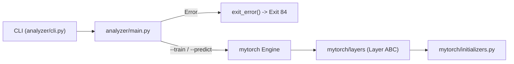

# Project Structure & Architecture

This document explains the directory layout, architectural design, and core modules of **OurTorch**.

---

## 1. Directory Structure

```text
OurTorch/
├── Makefile                    # Build system for my_torch_analyzer & my_torch_generator
├── README.md                   # General project overview and usage guide
├── ARCHITECTURE.md             # Detailed structure and technical explanations
├── .gitignore                  # Git ignore rules for caches, venvs, and binaries
│
├── mytorch/                    # Custom lightweight neural network library
│   ├── __init__.py             # Package initialization
│   ├── initializers.py         # Weight initialization strategies (Xavier, He, LeCun)
│   └── layers/                 # Neural network layers package
│       ├── __init__.py         # Exposes Layer base class (and future layers)
│       └── base.py             # Abstract base class `Layer`
│
├── analyzer/                   # Chessboard analyzer application
│   ├── __init__.py             # Package initialization
│   ├── main.py                 # Entrypoint copied to ./my_torch_analyzer
│   ├── cli.py                  # Strict CLI parser & argument validator
│   └── utils.py                # Central error handling (`exit_error`)
│
├── scripts/                    # Standalone scripts and tools
│   └── generator.py            # Entrypoint copied to ./my_torch_generator
│
└── tests/                      # Unit test suite
    ├── __init__.py             # Test path configuration
    ├── test_cli.py             # Unit tests for CLI parsing and exit code 84 rules
    └── test_initializers.py    # Unit tests for initializers and base Layer
```

---

## 2. Build System (`Makefile`)

Because Python is an interpreted language, the `Makefile` packages the entrypoints as standalone executables using standard POSIX permissions and the `#!/usr/bin/env python3` shebang at the top of each entrypoint:

| Rule | Action |
| :--- | :--- |
| `make` / `make all` | Copies `analyzer/main.py` $\rightarrow$ `./my_torch_analyzer` and `scripts/generator.py` $\rightarrow$ `./my_torch_generator`, and runs `chmod +x` on both. |
| `make clean` | Removes `__pycache__`, `.pytest_cache`, and `*.pyc` files across the workspace. |
| `make fclean` | Runs `clean` and deletes `./my_torch_analyzer` and `./my_torch_generator`. |
| `make re` | Runs `fclean` followed by `all`. |

---

## 3. Core Modules Breakdown

### 3.1 Analyzer Package (`analyzer/`)

#### `analyzer/utils.py`
Provides centralized error reporting required by the specification:
- **`exit_error(message: str) -> None`**:
  Writes `f"Error: {message}\n"` to `sys.stderr` and terminates the process with `sys.exit(84)`.

#### `analyzer/cli.py`
Handles command-line parsing without relying on `argparse`'s default exit code (`2`), ensuring every validation failure exits with code `84`.
- **`AnalyzerArgs`**: A `@dataclass` holding the validated parameters:
  - `mode: str` (`"train"` or `"predict"`)
  - `loadfile: str` (path to the neural network file)
  - `chessfile: str` (path to the FEN dataset file)
  - `savefile: Optional[str]` (optional output path when `--train` is active)
- **Validation Rules**:
  1. `-h` or `--help` prints the exact specification usage to `stdout` and exits with `0`.
  2. Exactly one mode (`--train` or `--predict`) must be specified.
  3. `--save SAVEFILE` is only permitted with `--train` (using `--save` with `--predict` exits with `84`).
  4. Both `LOADFILE` and `CHESSFILE` must exist, be regular files, be readable, and be non-empty (`size > 0`).

---

### 3.2 Neural Network Library (`mytorch/`)

#### `mytorch/initializers.py`
Implements standard weight initialization strategies to prevent vanishing or exploding gradients during forward and backward propagation. All functions accept `shape: tuple[int, int]` representing `(n_in, n_out)` and return a `np.ndarray` of dtype `np.float32`.

| Function | Formula / Distribution | Typical Use Case |
| :--- | :--- | :--- |
| `xavier_normal(shape)` | $\mathcal{N}\!\left(0, \sqrt{\frac{2}{n_{\text{in}} + n_{\text{out}}}}\right)$ | Tanh / Sigmoid / Logistic activations |
| `xavier_uniform(shape)` | $\mathcal{U}\!\left(-\sqrt{\frac{6}{n_{\text{in}} + n_{\text{out}}}}, \sqrt{\frac{6}{n_{\text{in}} + n_{\text{out}}}}\right)$ | Tanh / Sigmoid / Logistic activations |
| `he_normal(shape)` | $\mathcal{N}\!\left(0, \sqrt{\frac{2}{n_{\text{in}}}}\right)$ | ReLU and Leaky ReLU activations |
| `lecun_normal(shape)` | $\mathcal{N}\!\left(0, \sqrt{\frac{1}{n_{\text{in}}}}\right)$ | SELU / standard normalizing networks |

- **`get_initializer(name: str)`**: Factory lookup that normalizes the initializer name (and supports common aliases like `glorot_normal`, `kaiming_normal`) and raises a `ValueError` if an unknown name is requested.

#### `mytorch/layers/base.py`
Defines the abstract base class **`Layer(ABC)`**, which forms the contract for all layers (Dense/Linear, Activation layers, Dropout, BatchNorm, etc.):
- **`self.training: bool = True`**: Tracks whether the layer is in training mode or inference/evaluation mode (crucial for layers like Dropout or Batch Normalization).
- **`forward(self, inputs: np.ndarray) -> np.ndarray`** *(abstract)*: Computes layer output from input activations.
- **`backward(self, grad_output: np.ndarray) -> np.ndarray`** *(abstract)*: Computes gradient with respect to inputs ($\frac{\partial L}{\partial X}$) and accumulates parameter gradients ($\frac{\partial L}{\partial W}, \frac{\partial L}{\partial b}$).
- **`parameters(self) -> list[tuple[np.ndarray, np.ndarray]]`**: Returns pairs of `(parameter_array, gradient_array)` for optimizers to update. Returns `[]` by default for parameter-free layers.
- **`get_config(self) -> dict`**: Returns a dictionary describing the layer's configuration for saving/serializing models.

---

## 4. Component Interaction Flow


