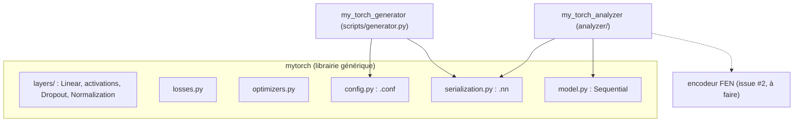
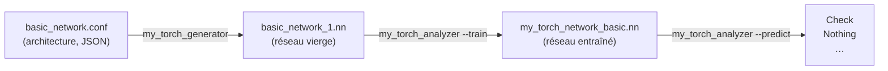

# 01 — Vue d'ensemble

## Le problème à résoudre

Le sujet (`SPECIFICATIONS.MD`) demande de prédire **l'état d'une partie d'échecs** à partir d'une position décrite en notation FEN :

```
rnb1kbnr/pppp1ppp/8/4p3/6Pq/5P2/PPPPP2P/RNBQKBNR w KQkq - 1 3   →   Checkmate White
```

Trois niveaux de précision existent, selon le réseau chargé :

| Niveau | Classes possibles | Config fournie |
| :--- | :--- | :--- |
| Basique | `Nothing`, `Check` | `configs/basic_network.conf` |
| Intermédiaire | `Nothing`, `Check`, `Checkmate` | `configs/medium_network.conf` |
| Complet | `Nothing`, `Check White`, `Check Black`, `Checkmate White`, `Checkmate Black` | `configs/full_network.conf` |

**Contraintes majeures** :
- **Interdiction** d'utiliser PyTorch, TensorFlow, Keras, scikit-learn… : le réseau, la rétropropagation et les optimiseurs sont **écrits à la main**. Seul **NumPy** est utilisé, pour le calcul matriciel.
- La prédiction **doit** venir d'un modèle appris par **apprentissage supervisé**. Un moteur d'échecs classique peut seulement servir à **générer les labels** du jeu d'entraînement.
- Toute erreur → message sur **stderr** et code de sortie **84**.

## Les trois briques du projet



1. **`mytorch/`** — une mini-librairie de réseaux de neurones, **générique** : elle ne sait rien des échecs. On pourrait l'utiliser pour n'importe quel problème de classification. C'est l'exigence « NN module » du sujet ([NN1] créer, [NN2] sauvegarder/charger, [NN3] entraîner).
2. **`my_torch_generator`** (`scripts/generator.py`) — crée des réseaux **vierges** (non entraînés) à partir de fichiers de configuration `.conf`. C'est l'exigence [GEN1].
3. **`my_torch_analyzer`** (`analyzer/`) — l'exécutable noté par l'autograder : `--train` pour entraîner un réseau sur des positions labellisées, `--predict` pour afficher une prédiction par position.

## Le cycle de vie d'un réseau



1. On **décrit** l'architecture dans un `.conf` : couches, classes, optimiseur, hyperparamètres d'entraînement, graine.
2. Le générateur **construit** le réseau (poids aléatoires) et le **sauvegarde** dans un `.nn`.
3. L'analyseur en mode `--train` **charge** le `.nn`, l'**entraîne** sur des positions labellisées, puis le **resauvegarde**.
4. L'analyseur en mode `--predict` **charge** le `.nn` entraîné et **prédit** l'état de chaque position.

## Ce qui se passe pour UNE prédiction

Exemple avec `medium_network.conf` :

```
position FEN
   │  encodeur FEN (issue #2)
   ▼
vecteur de 789 nombres                       X : (1, 789)
   │  Normalization   (X - moyenne) / écart-type
   ▼                                          (1, 789)
   │  Linear 789→256  X·W + b
   ▼                                          (1, 256)
   │  ReLU            max(0, x)
   │  Dropout         (inactif en prédiction)
   │  Linear 256→128 ; ReLU ; Dropout
   ▼                                          (1, 128)
   │  Linear 128→3
   ▼
logits [-1.2, 3.4, 0.7]                      (1, 3)
   │  softmax
   ▼
probabilités [0.01, 0.93, 0.06]
   │  argmax → classes[1]
   ▼
"Check"
```

## Ce qui se passe pendant l'entraînement

Pour chaque mini-batch de positions :
1. **Forward** : le réseau calcule ses prédictions (logits).
2. **Loss** : on mesure l'erreur entre prédictions et labels attendus (cross-entropy).
3. **Backward** : on calcule, pour chaque poids, dans quel sens le modifier pour réduire l'erreur (gradient).
4. **Optimiseur** : on modifie légèrement chaque poids dans ce sens (Adam ou SGD).

Après chaque époque, on mesure l'erreur sur un **jeu de validation** jamais utilisé pour apprendre. Si elle ne s'améliore plus, on arrête (**early stopping**) et on garde les meilleurs poids. Détails : [02 — Théorie](02-theorie.md) et [04 — Entraînement](04-entrainement.md).

## Organisation des fichiers

```
OurTorch/
├── Makefile                 make / re / clean / fclean → crée les 2 exécutables
├── README.md                présentation courte (anglais)
├── ARCHITECTURE.md          référence technique courte (anglais)
├── SPECIFICATIONS.MD        cahier des charges
├── docs/                    cette documentation (français)
├── configs/                 basic / medium / full_network.conf
├── mytorch/                 la librairie
├── analyzer/                my_torch_analyzer
│   ├── main.py              point d'entrée (copié en ./my_torch_analyzer)
│   ├── cli.py               lecture et validation des arguments
│   └── utils.py             exit_error() : stderr + code 84
├── scripts/
│   └── generator.py         my_torch_generator (copié en ./my_torch_generator)
└── tests/                   tests unitaires et de bout en bout (pytest / unittest)
```

## État d'avancement

| Composant | État | Issue |
| :--- | :--- | :--- |
| Structure, Makefile, gestion d'erreurs | ✅ | #9 |
| Parsing des arguments de l'analyseur | ✅ | #7 |
| Initialiseurs de poids, classe `Layer` | ✅ | #8 |
| Couches `Linear`, activations, `Dropout` | ✅ | #5 |
| Losses, optimiseurs, `Sequential` | ✅ | #4 |
| Normalisation, `.conf`, `.nn`, générateur | ✅ | #3 |
| Encodeur FEN | ⏳ | #2 |
| Pipelines `--train` / `--predict` | ⏳ | #1 |
| Benchmarks, réseaux pré-entraînés | ⏳ | #6 |

Aujourd'hui, `./my_torch_analyzer` valide ses arguments mais n'entraîne ni ne prédit encore : il manque l'encodeur FEN (#2) et le branchement (#1).
