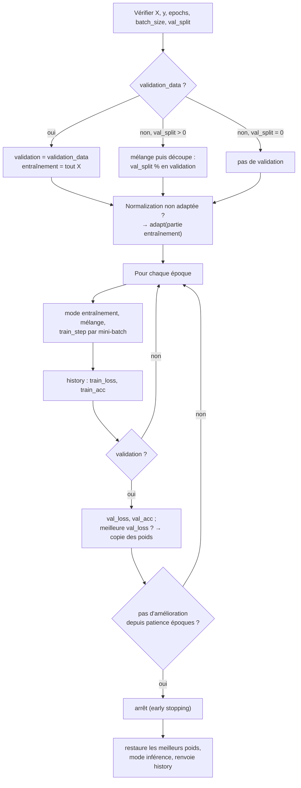

# 04 — Entraînement : losses, optimiseurs, `Sequential`

```python
from mytorch import Sequential, MSELoss, SoftmaxCrossEntropyLoss, get_loss, SGD, Adam, get_optimizer
```

## 1. Les losses (`losses.py`)

Une loss expose deux méthodes :

| Méthode | Rôle |
| :--- | :--- |
| `forward(y_pred, y_true) -> float` | Erreur moyenne sur le batch. Mémorise ce dont `backward` a besoin. Formes différentes → `ValueError`. |
| `backward() -> ndarray` | $\frac{\partial L}{\partial y_{pred}}$, de même forme que `y_pred`. C'est le point de départ de la rétropropagation. Avant `forward` → `RuntimeError`. |
| `output_transform(outputs)` | Transforme les sorties brutes du réseau en prédictions : softmax pour la cross-entropy, identité pour MSE. Utilisé par `Sequential.predict_proba()`. |
| `name` / `get_config()` | Nom utilisé dans les `.conf` (`"cross_entropy"`, `"mse"`). |

### `SoftmaxCrossEntropyLoss` — `"cross_entropy"` (classification)

- **Entrée** : les **logits bruts** du réseau (pas de couche `Softmax` avant !) et des labels **one-hot**.
- **Forward** : $L = -\frac{1}{N}\sum Y \log \text{softmax}(z)$.
- **Backward** : $\frac{\text{softmax}(z) - Y}{N}$ (voir [02 §6](02-theorie.md#le-cas-élégant-softmax--cross-entropy)).
- **Stabilité** : $\log \text{softmax}(z)$ est calculé avec l'astuce *log-sum-exp* : $z - \max z - \log \sum e^{z - \max z}$. On ne calcule donc jamais $\log(0)$, même avec des logits extrêmes (testé avec ±1000). L'issue proposait d'écrêter les probabilités à $[10^{-15}, 1]$, ce qui fausse légèrement les valeurs ; notre méthode est exacte.

### `MSELoss` — `"mse"` (régression)

- **Forward** : $L = \text{moyenne}((\hat{y} - y)^2)$ sur **tous** les éléments ($N \times K$).
- **Backward** : $\frac{2(\hat{y} - y)}{N \cdot K}$, cohérent avec cette moyenne (vérifié par gradient check). La formule de l'issue divisait seulement par $N$, ce qui ne correspondait pas au forward.
- Peu adaptée à la classification (gradients faibles quand le réseau se trompe beaucoup) ; disponible pour comparer dans les benchmarks.

### `get_loss(name)` et `softmax(logits)`

- `get_loss("cross_entropy")` crée une loss depuis son nom (alias : `crossentropy`, `softmax_cross_entropy`, `mse`). Nom inconnu → `ValueError`.
- `softmax(logits)` : fonction utilitaire, softmax stable par ligne.

---

## 2. Les optimiseurs (`optimizers.py`)

Un optimiseur reçoit la liste `[(param, grad), ...]` de `Sequential.parameters()` et **modifie chaque `param` en place** avec `step(parameters)`.

Paramètres communs (classe de base `Optimizer`) :
- `lr` : learning rate, > 0 (sinon `ValueError`). C'est un simple attribut : on peut le modifier entre deux époques pour faire un *planning* de learning rate.
- `weight_decay` : coefficient de régularisation **L2**, ≥ 0. Ajoute $\lambda \cdot p$ au gradient, ce qui revient à minimiser $L + \frac{\lambda}{2}\lVert p\rVert^2$ : les grands poids sont pénalisés **[OPT1]**. Appliqué à tous les paramètres, biais compris (choix de simplicité).

L'état interne (vitesse, moments) est rangé dans un dictionnaire indexé par `id(param)`. C'est pour cela que les couches ne doivent jamais réallouer leurs tableaux ([03 — Conventions](03-couches.md#conventions-à-respecter-pour-toute-nouvelle-couche)).

### `SGD(lr=0.01, momentum=0.9, weight_decay=0.0)`

$$v \leftarrow \mu v - \eta g \qquad p \leftarrow p + v$$

Le **momentum** $\mu$ accumule une « vitesse » : les directions qui reviennent à chaque pas s'accélèrent, les oscillations s'annulent. Image : une bille qui roule dans une vallée plutôt qu'un marcheur qui s'arrête à chaque pas. Avec `momentum=0`, c'est la descente de gradient simple $p \leftarrow p - \eta g$. `momentum` doit être dans $[0, 1)$.

### `Adam(lr=0.001, beta1=0.9, beta2=0.999, eps=1e-8, weight_decay=0.0)`

$$m \leftarrow \beta_1 m + (1-\beta_1) g \qquad v \leftarrow \beta_2 v + (1-\beta_2) g^2$$
$$\hat{m} = \frac{m}{1-\beta_1^t} \quad \hat{v} = \frac{v}{1-\beta_2^t} \qquad p \leftarrow p - \eta \frac{\hat{m}}{\sqrt{\hat{v}} + \epsilon}$$

- $m$ : moyenne des gradients récents (comme le momentum).
- $v$ : moyenne des **carrés** des gradients. Diviser par $\sqrt{v}$ donne à **chaque poids son propre pas** : un poids aux gradients énormes avance prudemment, un poids aux gradients minuscules avance quand même.
- **Correction de biais** ($\hat{m}$, $\hat{v}$) : $m$ et $v$ partent de 0, donc sont sous-estimés au début. Diviser par $1 - \beta^t$ corrige cela. Conséquence vérifiée par un test : le premier pas d'Adam vaut environ `lr` dans le sens opposé au gradient, quelle que soit la taille du gradient.
- `t` compte le nombre d'appels à `step()`.

**Lequel choisir ?** Adam est le défaut de nos configs : il converge vite avec peu de réglages. SGD + momentum généralise parfois un peu mieux mais demande d'ajuster le learning rate. Les deux sont à comparer dans les benchmarks (issue #6).

### `get_optimizer(config)`

Construit un optimiseur depuis une entrée de `.conf` :

```python
get_optimizer({"type": "adam", "lr": 0.001, "weight_decay": 1e-4})
get_optimizer({"type": "sgd", "lr": 0.05, "momentum": 0.9})
```

Type inconnu, paramètre inconnu ou valeur invalide → `ValueError`. `get_config()` renvoie le dictionnaire inverse (avec tous les paramètres).

---

## 3. Le modèle : `Sequential` (`model.py`)

```python
Sequential(layers, loss, optimizer, classes, training_config=None, seed=None)
```

| Argument | Rôle |
| :--- | :--- |
| `layers` | Liste ordonnée de couches (non vide). `Normalization` uniquement en premier, sinon `ValueError`. |
| `loss` | Instance de loss. |
| `optimizer` | Instance d'optimiseur. |
| `classes` | Noms des sorties, dans l'ordre des neurones de sortie : neurone *i* ↔ `classes[i]`. Les labels d'entraînement sont des one-hot dans **le même ordre**. |
| `training_config` | Réglages d'entraînement venant du `.conf` : `epochs`, `batch_size`, `val_split`, `patience`. |
| `seed` | Graine du `.conf`, conservée pour la reproductibilité. |

### Méthodes

| Méthode | Ce qu'elle fait |
| :--- | :--- |
| `train()` / `eval()` | Passe toutes les couches en mode entraînement / inférence (active / désactive le Dropout). |
| `forward(X)` | Applique les couches dans l'ordre. |
| `backward(grad)` | Applique les `backward` dans l'ordre **inverse**. |
| `parameters()` | Toutes les paires `(param, grad)` de toutes les couches. |
| `train_step(X_batch, y_batch)` | Un pas d'apprentissage : forward → loss → backward → `optimizer.step()`. Renvoie la loss du batch. |
| `fit(X, y, epochs, batch_size, val_split=0.15, patience=5, validation_data=None, verbose=False)` | Boucle d'entraînement complète (détaillée ci-dessous). Renvoie un `history`. |
| `evaluate(X, y, batch_size=1024)` | `(loss moyenne, accuracy)` en mode inférence, sans modifier le mode courant ni les poids. |
| `predict_proba(X, batch_size=1024)` | Sorties passées par `loss.output_transform` (probabilités), calculées par paquets de 1024 pour limiter la mémoire. Passe le modèle en mode inférence. |
| `predict(X, batch_size=1024)` | Liste des noms de classes prédits (`argmax`). Nombre de sorties ≠ nombre de classes → `ValueError`. |
| `get_config()` | `{"classes", "loss", "optimizer", "layers", "training", "seed"}` : même structure qu'un `.conf`. |

### `fit()` étape par étape



1. **Validation** : `validation_data=(X_val, y_val)` si fourni ; sinon une fraction `val_split` tirée au hasard est mise de côté ; `val_split=0` → aucune validation (et donc pas d'early stopping).
2. **Normalisation** : si la première couche est une `Normalization` jamais adaptée, ses statistiques sont calculées sur la partie entraînement.
3. **Chaque époque** : mode entraînement, ordre des exemples mélangé, un `train_step` par mini-batch de `batch_size`.
4. **Mesures** : `train_loss` (moyenne des loss des batchs, pondérée par leur taille), `train_acc`, puis `val_loss`, `val_acc`.
5. **Early stopping** : à chaque nouvelle meilleure `val_loss`, une copie des poids est gardée. Après `patience` époques sans amélioration, on s'arrête. `patience=None` désactive l'arrêt.
6. **Fin** : les meilleurs poids sont restaurés, le modèle passe en mode inférence.

**`history` renvoyé** :

```python
{
    "train_loss": [1.08, 0.74, ...],   # une valeur par époque
    "train_acc":  [0.41, 0.66, ...],
    "val_loss":   [1.02, 0.80, ...],   # vide sans validation
    "val_acc":    [0.45, 0.61, ...],
    "best_epoch": 7,                    # numéro (à partir de 1) de l'époque retenue, None sans validation
}
```

C'est la matière première des courbes d'apprentissage des benchmarks (issue #6).

**`verbose=True`** affiche une ligne par époque **sur stderr** :
```
epoch 3/30 - loss 0.6123 - acc 0.7810 - val_loss 0.6544 - val_acc 0.7600
```
Pourquoi stderr : en mode `--predict`, l'autograder compare **stdout ligne à ligne**. Aucun log ne doit y apparaître.

### Reproductibilité

Le mélange des données, le découpage de validation, l'initialisation des poids et les masques de Dropout utilisent tous le générateur aléatoire global de NumPy. Un `np.random.seed(s)` avant la construction et l'entraînement reproduit **exactement** le même entraînement (testé). `build_from_config` le fait automatiquement avec la graine du `.conf`.

### Exemple complet

```python
import numpy as np
from mytorch import Adam, Sequential, SoftmaxCrossEntropyLoss
from mytorch.layers import Dropout, Linear, Normalization, ReLU

np.random.seed(42)
model = Sequential(
    layers=[Normalization(773), Linear(773, 256, init="he"), ReLU(), Dropout(0.2),
            Linear(256, 3, init="xavier")],
    loss=SoftmaxCrossEntropyLoss(),           # le réseau sort des logits : pas de Softmax
    optimizer=Adam(lr=0.001, weight_decay=1e-4),
    classes=["Nothing", "Check", "Checkmate"],
)

X = np.random.rand(1000, 773).astype(np.float32)                 # features (en vrai : encode_fens(...))
y = np.eye(3, dtype=np.float32)[np.random.randint(0, 3, 1000)]   # one-hot, même ordre que classes

history = model.fit(X, y, epochs=30, batch_size=128, val_split=0.15, patience=5, verbose=True)
print(history["best_epoch"])
print(model.evaluate(X, y))      # (loss, accuracy)
print(model.predict(X[:3]))      # par ex. ['Nothing', 'Nothing', 'Checkmate']
```

En pratique, on construit plutôt le modèle depuis un `.conf` : [05 — Configuration et sauvegarde](05-configuration-et-sauvegarde.md).
